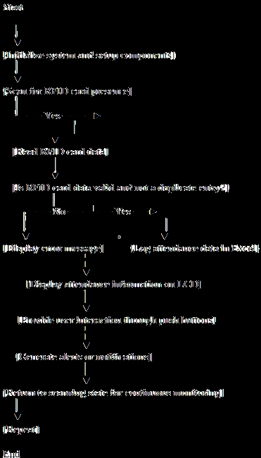

# RFID-Based Smart Attendance System with Microsoft Excel Logging

[](https://www.arduino.cc/)
[](https://isocpp.org/)
[](https://www.python.org/)
[](https://www.microsoft.com/excel)
[-blue.svg)]()
[](LICENSE)

An automated, contactless student attendance recording system powered by an **Arduino Uno R3**, an **MFRC522 13.56 MHz RFID transceiver**, and an **I2C 16x2 character LCD display**. The system captures student card UIDs, cross-references credentials with a pre-configured database, provides immediate multi-sensory feedback (LCD greeting, dual LEDs, buzzer tones), and automatically logs timestamped records directly into a formatted **Microsoft Excel (`.xlsx`)** datasheet.

Developed as a term project for **ECE 202: Electronic Circuit Design Sessional**, Department of Electronics and Communication Engineering, Hajee Mohammad Danesh Science and Technology University (HSTU).

---

## ⚡ Circuit Schematic & Hardware Architecture

<div align="center">
  
  <p><em>Figure 1: Complete circuit schematic and hardware interconnect diagram between Arduino Uno, MFRC522 RFID module, I2C 16x2 LCD, LEDs, and Piezo Buzzer.</em></p>
</div>

---

## 📊 Live Attendance Logging in Microsoft Excel

Every valid swipe is timestamped with system date and time, student name, university registration ID, and status (`Present`), appended automatically in real-time.

<div align="center">
  
  <p><em>Figure 2: Real-time automated attendance logging output generated in Microsoft Excel.</em></p>
</div>

---

## 🌟 Key Features

- **Contactless 13.56 MHz RFID Identification:** Fast and hygienic badge scanning using the ISO/IEC 14443A standard (MFRC522).
- **Dual-Mode Excel Synchronization:**
  - **Option A (Python Serial Bridge):** An automated Python script (`attendance_logger.py`) that monitors the COM port and writes records into a styled `.xlsx` workbook using `openpyxl`.
  - **Option B (Direct PLX-DAQ):** Direct serial communication protocol enabling real-time macro-driven streaming into open Microsoft Excel sheets.
- **Duplicate Entry Rejection:** Prevents accidental or deliberate double-swiping within the same attendance session.
- **Audio-Visual Real-Time Feedback:**
  - **Authorized:** Green LED illuminates, dual short buzzer beeps, personalized LCD greeting with student ID.
  - **Duplicate:** Green + Red LED blink, warning triple chirp, "Already Marked!" displayed on LCD.
  - **Unauthorized:** Red LED illuminates, long warning beep, "Access Denied!" LCD prompt.
- **Cost-Effective Implementation:** Turnkey hardware constructed using readily available educational electronics components.

---

## 🔄 System Architecture & Operational Workflow

<div align="center">
  
  <p><em>Figure 3: Algorithmic decision flowchart detailing tag interrogation, authorization lookup, visual/audio feedback, and Excel synchronization.</em></p>
</div>

```mermaid
flowchart TD
    A([System Boot & Peripheral Init]) --> B[Display 'Scan Your Card..' on 16x2 LCD]
    B --> C{New RFID Tag<br/>Detected?}
    C -->|No| B
    C -->|Yes| D[Read Hex Card UID via SPI]
    D --> E{Is UID Registered in<br/>Student Database?}
    
    E -->|No| F[Access Denied!<br/>Red LED HIGH + Long Warning Tone]
    F --> B
    
    E -->|Yes| G{Already Marked<br/>in Session?}
    G -->|Yes| H[Already Marked Warning!<br/>Dual LED Blink + Triple Chirp]
    H --> B
    
    G -->|No| I[Mark Attendance: Attended = True]
    I --> J[Display 'Welcome [Name]' & Student ID on LCD]
    J --> K[Green LED HIGH + Dual Chirp Confirmation]
    K --> L[Stream Record to Serial Bus: PLX-DAQ / JSON]
    L --> M[(Append Timestamped Entry to Excel Sheet)]
    M --> B
```

---

## 🔌 Hardware Pinout Configuration

| Module / Component | Arduino Uno Pin | Protocol / Signal Type | Operating Voltage |
| :--- | :--- | :--- | :--- |
| **MFRC522 SDA (SS)** | **Digital Pin 10** | SPI Slave Select | 3.3V Logic |
| **MFRC522 SCK** | **Digital Pin 13** | Hardware SPI Clock | 3.3V Logic |
| **MFRC522 MOSI** | **Digital Pin 11** | Hardware SPI MOSI | 3.3V Logic |
| **MFRC522 MISO** | **Digital Pin 12** | Hardware SPI MISO | 3.3V Logic |
| **MFRC522 RST** | **Digital Pin 9** | Hardware Reset | 3.3V Logic |
| **MFRC522 VCC** | **3.3V Header** | Power Supply | ⚠️ **3.3V ONLY** |
| **16x2 LCD SDA** | **Analog Pin A4** | I2C Serial Data | 5.0V |
| **16x2 LCD SCL** | **Analog Pin A5** | I2C Serial Clock | 5.0V |
| **Green Status LED** | **Digital Pin 5** | GPIO Out ($220\,\Omega$ resistor) | 5.0V |
| **Red Status LED** | **Digital Pin 6** | GPIO Out ($220\,\Omega$ resistor) | 5.0V |
| **Piezo Buzzer** | **Digital Pin 8** | Digital Audio Out | 5.0V |

*For complete electrical guidelines and troubleshooting, see [hardware/circuit_pinout.md](hardware/circuit_pinout.md).*

---

## 🚀 Getting Started

### 1. Arduino Firmware Setup
1. Install the required Arduino libraries via the Library Manager (`Ctrl + Shift + I`):
   - **`MFRC522`** by GithubCommunity
   - **`LiquidCrystal_I2C`** by Frank de Brabander
2. Connect your Arduino Uno board via USB.
3. Open [`firmware/RFID_Attendance_System.ino`](firmware/RFID_Attendance_System.ino) in the Arduino IDE.
4. Select `Tools > Board > Arduino Uno` and choose your port.
5. Click **Upload** (`Ctrl + U`).

### 2. Python-to-Excel Bridge Setup (Recommended)
To automatically record swipe events directly into `Attendance_Log.xlsx`:

```bash
# Navigate to the python bridge directory
cd python_bridge

# Install Python dependencies
pip install -r requirements.txt

# Run the attendance daemon
python attendance_logger.py
```
The script will automatically detect your Arduino's serial port and create/update the formatted Excel file in real time.

---

## 📂 Repository Structure

```
rfid-attendance-system-arduino-excel/
├── firmware/
│   ├── RFID_Attendance_System.ino   # Main embedded sketch with MFRC522 & I2C LCD
│   └── config.h                      # Pin definitions, timing, & registered student database
├── python_bridge/
│   ├── attendance_logger.py          # Python daemon logging serial telemetry to Excel
│   └── requirements.txt              # Python dependencies (pyserial, openpyxl, pandas)
├── hardware/
│   └── circuit_pinout.md             # Detailed wiring diagram, pin mapping, and voltage specs
├── docs/
│   └── assets/                       # Circuit schematic, flowchart, and Excel output screenshots
├── .gitignore                        # Clean ignore rules for builds, temporary Excel locks
├── LICENSE                           # MIT Open-Source License
└── README.md                         # Project documentation
```

---

## 👥 Authors & Project Team

**Group 08 — Level 2, Semester I**  
Department of Electronics and Communication Engineering  
Hajee Mohammad Danesh Science and Technology University (HSTU), Dinajpur, Bangladesh

- **Md. Al-Imran** (Student ID: 2102129) — *Lead Developer & Embedded Firmware*  
  GitHub: [@imran7976](https://github.com/imran7976) | Email: ai.skhimran01@gmail.com
- **Mukund Mohan Mishra** (Student ID: 2102161)
- **Md. Mohsin Ahmed** (Student ID: 2102108)
- **Md. Abul Kashem** (Student ID: 2102115)

**Course Instructor / Supervisor:**  
**Md. Abubakar Siddik**, *Assistant Professor*, Dept. of ECE, HSTU
