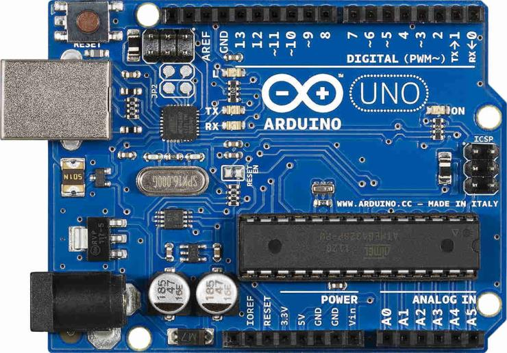

# Hardware Architecture & Circuit Interconnects

## 1. Schematic Overview

The system interfaces an **MFRC522 RFID reader** (via SPI), a **16x2 Character LCD** (via I2C), dual visual status LEDs, and an active piezo buzzer to an **Arduino Uno R3**.

  
  
<em>Figure 1: Complete circuit schematic and pin interconnect diagram between Arduino Uno, MFRC522, I2C LCD, LEDs, and Buzzer.</em>

---

## 2. Complete Pinout Table

### A. MFRC522 RFID Reader (SPI Interface)
| MFRC522 Pin | Arduino Uno Pin | Logic Level | Notes / Function |
| :--- | :--- | :--- | :--- |
| **VCC** | **3.3V** | 3.3V DC | ⚠️ **DO NOT CONNECT TO 5V** (Will permanently destroy RC522) |
| **RST** | **Pin 9** | Digital Out | Hardware reset line |
| **GND** | **GND** | Ground | Common ground |
| **IRQ** | *Unconnected* | -- | Interrupt not required for polling mode |
| **MISO** | **Pin 12** | SPI In | Master In Slave Out |
| **MOSI** | **Pin 11** | SPI Out | Master Out Slave In |
| **SCK** | **Pin 13** | SPI Clock | Serial SPI Clock |
| **SDA (SS)** | **Pin 10** | Digital Out | Slave Select / Chip Select |

### B. 16x2 I2C LCD Display (PCF8574 Backpack)
| LCD I2C Pin | Arduino Uno Pin | Description |
| :--- | :--- | :--- |
| **GND** | **GND** | Ground reference |
| **VCC** | **5V** | 5V Power supply |
| **SDA** | **Pin A4** | I2C Serial Data |
| **SCL** | **Pin A5** | I2C Serial Clock |

### C. Audio-Visual Feedback Indicators
| Component | Connection Pin | Current Limiter | Purpose |
| :--- | :--- | :--- | :--- |
| **Green LED** | **Pin 5** | $220\,\Omega$ Resistor | Lights up on valid attendance check-in |
| **Red LED** | **Pin 6** | $220\,\Omega$ Resistor | Lights up on access denied / duplicate card |
| **Active Buzzer** | **Pin 8** | Direct logic | Audio chirp (single for success, long for error) |

---

## 3. Power Architecture & Precautions
1. **3.3V Supply Rail:** The MFRC522 operates exclusively on $3.3\text{ V}$. Connecting it to the $5\text{ V}$ header on the Arduino will damage the silicon.
2. **I2C Bus Addressing:** The PCF8574 I2C adapter typically occupies address `0x27`. If the LCD backlight illuminates without text, change `LCD_I2C_ADDR` in `config.h` to `0x3F` or run an I2C scanner sketch.
